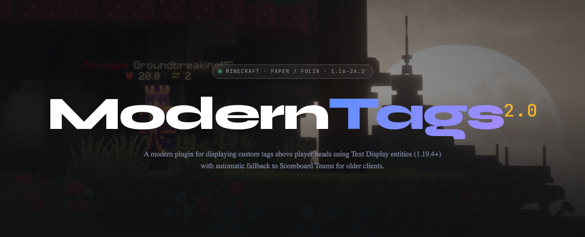

# ModernTags

Custom nametags for Minecraft servers. Players on 1.19.4 and newer see tags made of Text
Display entities; older clients get a prefix and a suffix around the vanilla name.

[Русская версия](README_RU.md) · [Documentation](wiki/README.md)

## Features

- **Styled tags**: colors, gradients, several lines, scale, background, shadow, alignment.
- **Animation**: any number of frames with their own text and look.
- **Tags by condition**: pick a tag by permission, PlaceholderAPI value or client version,
  separately for the tag's owner and for each viewer.
- **Per-viewer text**: `{viewer:...}` placeholders show every viewer their own version.
- **Vanilla behaviour**: tags fade while sneaking, disappear for invisible and dead players,
  and spectators see what they see in vanilla.
- **Works with TAB and glow plugins**: their team colors are kept, and TAB's nametags do not
  have to be turned off.
- **Old clients**: scoreboard team tags with a value below the name, chosen per viewer.

## Technical details

- Built on PacketEvents
- Text is built with [GikyMessage](https://github.com/groundbreakingmc/GikyMessage)
- Runs on Spigot, Paper and forks
- Tags are handled off the main server thread

## Requirements

- Java 21 and Spigot or Paper 1.20.2 or newer
- [PacketEvents](https://modrinth.com/plugin/packetevents)

Optional:

- [PlaceholderAPI](https://www.spigotmc.org/resources/placeholderapi.6245/) for placeholders
  of other plugins
- [VaultSlim](https://modrinth.com/plugin/vaultslim) or Vault for prefixes and suffixes
- [LuckPerms](https://luckperms.net/download): prefixes and suffixes are read from it
  directly when it provides the Vault chat

## Quick start

1. Put PacketEvents and ModernTags into `plugins/` and start the server.
2. Edit `plugins/ModernTags/config.yml` and the tags in `plugins/ModernTags/tags/`.
3. Run `/moderntags reload` to apply the changes.
   An invalid value stops the reload with an error in the console, and the previous
   configuration stays active.

The default configuration gives everyone a tag with prefix, name, suffix and health, and an
animated tag to players with `moderntags.tag.vip`.

## Commands and permissions

| Command | Description |
|---|---|
| `/moderntags`, `/moderntags reload` | Reload the configuration |
| `/moderntags update` | Download an update for the next restart |

| Permission | Default | Description |
|---|---|---|
| `moderntags.admin` | operators | Use `/moderntags` |
| `moderntags.see.own` | nobody | See your own tag |

## Documentation

The settings are described in the comments of `config.yml` and the tag files. The
documentation covers the rest:

- [Text and placeholders](wiki/text-and-placeholders.md)
- [Choosing a tag](wiki/conditions.md)
- [Examples](wiki/examples.md)
- [Performance](wiki/performance.md)

For tag text syntax, see the GikyMessage wiki:
[cheat sheet](https://github.com/groundbreakingmc/GikyMessage/blob/main/wiki/cheatsheet.md),
[colors and styles](https://github.com/groundbreakingmc/GikyMessage/blob/main/wiki/colors.md),
[gradients](https://github.com/groundbreakingmc/GikyMessage/blob/main/wiki/gradients.md),
[conditional text](https://github.com/groundbreakingmc/GikyMessage/blob/main/wiki/conditions.md),
[transforms](https://github.com/groundbreakingmc/GikyMessage/blob/main/wiki/transforms.md) and
[escaping and YAML](https://github.com/groundbreakingmc/GikyMessage/blob/main/wiki/escapes.md).
Use the ModernTags placeholder names listed in [Text and placeholders](wiki/text-and-placeholders.md).

ModernTags sends anonymous statistics to [bStats](https://bstats.org). To turn it off, set
`enabled: false` in `plugins/bStats/config.yml`.

## License

[Apache License 2.0](LICENSE)
