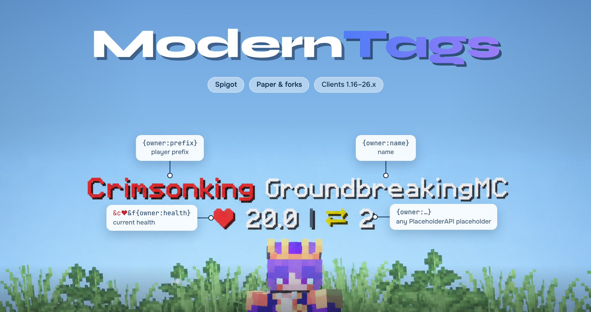

[Modrinth](https://modrinth.com/plugin/moderntags) • [Discord](https://discord.gg/vxa6CA5VRp) • [Documentation](wiki/README.md) • [Русская версия](README_RU.md)

## Many times better than other tag plugins

| Plugin | Memory allocated with 50 players |
|---|---:|
| **ModernTags** | **2.1 MB/s** |
| UnlimitedNameTags | 63.6 MB/s |

Measured with spark over 5 minutes of the same load test, with equivalent plugin settings.

- **Creates no entities on the server.** The tag exists only on players' screens, which takes the load off the world.
- **Runs off the main thread.** Tag updates stay off the main thread and don't take time away from server ticks.
- **Sends no movement packets.** The tag is attached to the player, and its frames are pre-optimized for sending.
- **Built for high player counts.** The plugin runs on parallel threads and keeps garbage collector load to a minimum.

## Tags work on any client version

**Modern tags** (clients 1.19.4 and newer)

- Multiple lines, any colors and gradients
- Adjustable size, position and alignment
- Background, opacity and visibility through walls
- Moves smoothly with the player

**Classic tags** (clients before 1.19.4)

- Prefix and suffix with colors and placeholders
- Any name color
- Works with glow plugins
- Health or another number below the name

## Tag styling

Tags use the same & codes as most other plugins. Add a few frames and you get an animation, like a shimmering gradient.

| In the config | What it is |
|---|---|
| `&6Gold &eyellow &cred` | Standard Minecraft colors |
| `&#55ffffAny hex color` | Any of 16 million colors |
| `[Gradient](gradient:#ff5555-#ffff55)` | A gradient between any colors |
| `$#7a2fd1Colored shadow` | Any shadow color |
| `&c❤ &f{owner:health}` | Player data, like health |

More on colors, several lines and brackets: [Text and placeholders](wiki/text-and-placeholders.md).

## What else ModernTags can do

- **Tags by condition.** The tag is chosen by permission, group, placeholder value or client version. Conditions can also check the viewer, so allies and enemies see different tags above the same player.
- **Behaves like a regular name tag.** The tag fades when the player sneaks and disappears if they're invisible or dead. In spectator mode, the tags of invisible players stay visible.
- **TAB and glow plugins.** They work alongside ModernTags with nothing to turn off, and glow colors are kept.
- **One jar for every platform.** Works on Spigot, Paper and its forks. No separate builds needed.
- **Updates itself.** The plugin checks for new versions on startup and can download an update on its own. It's installed the next time the server restarts.
- **Your own tag.** With `moderntags.see.own`, a player can see their own tag, for example in third-person view.

## Simple configuration

All settings live in YAML files with comments in English and Russian. Tag groups are set up in `config.yml`, and each tag's look has its own file.

```yaml
updates:
  check: true
  auto-download: false

vault-mm-formatting: false
hide-tag-when-has-passenger: true
tick-rate: 50
conditions-recheck-rate: 20
sync-animation-on-each-target: true

# line below the name for older clients
legacy-general:
  below-name-value: "owner:health"
  below-name-text: "&c❤"

# the group with the highest priority is used
tags:
  - priority: 0
    entries:
      - priority: 0
        modern: tags/default.yml:<root>
        legacy: tags/default-legacy.yml:<root>

  - priority: 1
    owner-conditions: "hasPermission('moderntags.tag.vip')"
    entries:
      - priority: 0
        modern: tags/vip.yml:modern
        legacy: tags/vip.yml:legacy
```

A group is chosen by `owner-conditions`, which are checked for the player with the tag. Inside the group, an entry is chosen by `viewer-conditions`, which are checked for each player who sees the tag. In both cases the highest priority that matches wins.

`modern` and `legacy` point to a tag file and a section in it, like `tags/vip.yml:modern`. `<root>` means the whole file. Both parts can live in one file:

```yaml
modern:
  frame-update-rate: 10
  placeholders-update-rate: 10
  frames:
    - text: |-
        &6★ {owner:prefix}&r&e{owner:name}{owner:suffix} &r&6★
        &c❤&f{owner:health}
    - text: |-
        &e✦ {owner:prefix}&r&e{owner:name}{owner:suffix} &r&e✦
        &c❤&f{owner:health}

legacy:
  frame-update-rate: 10
  placeholders-update-rate: 10
  preserve-player-name-color: true
  ignored-colors: [ "white" ]
  frames:
    - prefix: "&e✦ {owner:prefix}"
      name-color: "yellow"
      suffix: "{owner:suffix} &e✦"
    - prefix: "&6★ {owner:prefix}"
      name-color: "yellow"
      suffix: "{owner:suffix} &6★"
```

Ready-made setups, including all tags in one file: [Examples](wiki/examples.md).

### When to show which tag

For example, you can show one tag to donors, another to moderators and a third to players on older versions. Conditions can be combined however you like.

- `hasPermission('…')` — the player has a permission
- `%placeholder%` — a placeholder value
- `{protocol_version}` — client version
- `==` `!=` `>` `>=` `<` `<=` — comparison
- `&&` `||` `!` `( )` — and, or, not, parentheses

```yaml
owner-conditions: "hasPermission('group.vip') && %player_level% >= 10"
```

VIP tag for players at level 10 and above.

How groups, entries and conditions are checked: [Choosing a tag](wiki/conditions.md).

## Appearance settings

The modern tag has 18 settings, including size, position, background and opacity. Each animation frame can be set up separately.

| Setting | Default | What it does |
|---|---|---|
| `text` | — | Tag text |
| `alignment` | `CENTER` | Line alignment |
| `line-width` | `200` | Maximum line width |
| `text-opacity` | `-1` | Text opacity |
| `sneak-opacity` | `60` | Opacity while the player sneaks |
| `shadowed` | `true` | Text shadow |
| `brightness` | `block-15` | Brightness |
| `view-range` | `1.0` | View distance |
| `see-through` | `false` | Visible through walls |
| `x-offset` | `0.0` | X offset |
| `y-offset` | `0.15` | Height above the head |
| `z-offset` | `0.0` | Z offset |
| `scale` | `1.0` | Size |
| `vertical-billboard` | `false` | Doesn't tilt with the camera |
| `background-color` | `#00000000` | Background color |
| `default-background` | `false` | Background like a regular name tag |
| `shadow-radius` | `0.0` | Size of the shadow under the tag |
| `shadow-strength` | `1.0` | How dark the shadow is |

**Classic frame** (before 1.19.4)

- `prefix` — text before the name
- `name-color` — name color
- `suffix` — text after the name

**Tag file** (all tags)

- `frames` — animation frames
- `frame-update-rate` — animation speed
- `placeholders-update-rate` — how often to update placeholders
- `preserve-player-name-color` — keep the name color from glow plugins
- `ignored-colors` — colors that won't be kept

**config.yml**

- `updates.check` — check for updates on startup
- `updates.auto-download` — download updates automatically
- `vault-mm-formatting` — read Vault prefixes as MiniMessage
- `hide-tag-when-has-passenger` — hide the tag while someone rides the player
- `tick-rate` — tag update interval in milliseconds
- `conditions-recheck-rate` — how often to recheck conditions
- `sync-animation-on-each-target` — a separate animation clock for each player
- `legacy-general.below-name-value` — number below the name for older clients
- `legacy-general.below-name-text` — label for that number

## Placeholders

A tag can show data about the player themselves or about whoever is looking at them. Built-in placeholders work, and so does any PlaceholderAPI expansion, with its colors.

| The player with the tag | The viewer | Value |
|---|---|---|
| `{owner:name}` | `{viewer:name}` | name |
| `{owner:display_name}` | `{viewer:display_name}` | display name |
| `{owner:health}` | `{viewer:health}` | health |
| `{owner:prefix}` | `{viewer:prefix}` | prefix from LuckPerms or Vault |
| `{owner:suffix}` | `{viewer:suffix}` | suffix from LuckPerms or Vault |
| `{owner:player_level}` | `{viewer:player_ping}` | any PAPI placeholder |

`owner` gives data about the player the tag is shown above. `viewer` gives data about the player looking at the tag, so everyone sees their own value.

`{rel:…}` works with PlaceholderAPI relational placeholders, which describe the two players together. For example, clan plugins use them to color names differently for allies and enemies.

More: [Placeholders](wiki/text-and-placeholders.md#placeholders) and [relational placeholders](wiki/text-and-placeholders.md#relational-placeholders).

## Technical details

Here's how ModernTags keeps the load on your server so low.

- **Its own text format.** Tag templates are compiled ahead of time with [GikyMessage](https://github.com/groundbreakingmc/GikyMessage), when the config loads. So updating a tag creates very few new objects, and the garbage collector has almost nothing to clean up.
- **Only the data that changed.** When a frame changes, the client gets only the metadata that changed, not the whole tag again.
- **No extra wrappers.** Where possible, the packets the plugin handles are read straight from bytes, without creating intermediate objects.
- **One packet for all viewers.** If several players see the same tag, most of the frame packet is built into bytes once and sent to all of them. Each update goes out in one network write, which keeps ping low.

How to keep your own tags just as light: [Performance](wiki/performance.md).

## Installation and management

**Commands**

- `/moderntags reload` — reload the config without restarting the server (`/moderntags` without arguments does the same)
- `/moderntags update` — check for and download a new version

**Permissions**

| Permission | Default | What it gives |
|---|---|---|
| `moderntags.admin` | operators | Access to the plugin's commands |
| `moderntags.see.own` | nobody | The player sees their own tag |

**Requirements**

- **PacketEvents 2.11+** (required)
- **Java 21, server 1.20+** (required)
- **PlaceholderAPI, Vault, LuckPerms** (optional)

### Updates

`updates.check` enables update checks on startup. When `updates.auto-download` is enabled too, an available update is downloaded to the server's update folder and installed on the next restart.

`/moderntags update` checks again and downloads an available update, even when startup checks or automatic downloads are off. While `updates.auto-download` is `true`, `update` is hidden from tab completion but still works if you type it. Reloading the config applies these settings without starting another automatic check.

### Metrics

ModernTags uses [bStats](https://bstats.org) for standard server and plugin statistics. To turn collection off, set `enabled: false` in the shared `plugins/bStats/config.yml` file.

## License

[Apache License 2.0](LICENSE)
