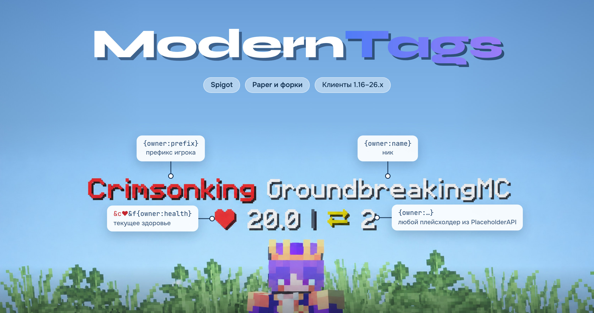

[Modrinth](https://modrinth.com/plugin/moderntags) • [Discord](https://discord.gg/vxa6CA5VRp) • [Документация](wiki/ru/README.md) • [English version](README.md)

## В десятки раз лучше аналогов

| Плагин | Выделение памяти при 50 игроках |
|---|---:|
| **ModernTags** | **2,1 МБ/с** |
| UnlimitedNameTags | 63,6 МБ/с |

Замер spark: 5 минут одного и того же нагрузочного теста, настройки плагинов одинаковые.

- **Не создаёт сущностей на сервере.** Тег есть только на экране у игроков, что снимает нагрузку с мира.
- **Работает вне основного потока.** Обновления тегов не занимают основной поток и не отнимают время у тиков сервера.
- **Не отправляет пакеты движения.** Тег закреплён за игроком, а кадры заранее оптимизированы для отправки.
- **Рассчитан на большой онлайн.** Плагин работает в параллельных потоках и сводит нагрузку на сборщик мусора к минимуму.

## Теги работают на любой версии клиента

**Современные теги** (клиенты 1.19.4 и новее)

- Несколько строк, любые цвета и градиенты
- Можно менять размер, положение и выравнивание
- Фон, прозрачность и видимость сквозь стены
- Плавно движется вместе с игроком

**Классические теги** (клиенты до 1.19.4)

- Префикс и суффикс с цветами и плейсхолдерами
- Любой цвет ника
- Совместим с плагинами свечения
- Под ником можно показать здоровье или другое число

## Оформление тегов

Тег оформляется привычными &-кодами, как в большинстве плагинов. А из нескольких кадров можно собрать анимацию, например переливающийся градиент.

| В конфиге | Что это |
|---|---|
| `&6Золото &eжёлтый &cкрасный` | Стандартные цвета Minecraft |
| `&#55ffffЛюбой hex-цвет` | Любой из 16 миллионов цветов |
| `[Градиент](gradient:#ff5555-#ffff55)` | Градиент из любых цветов |
| `$#7a2fd1Цветная тень` | Любой цвет тени |
| `&c❤ &f{owner:health}` | Данные игрока, например здоровье |

Подробнее о цветах, нескольких строках и скобках: [Текст и плейсхолдеры](wiki/ru/text-and-placeholders.md).

## Что ещё умеет ModernTags

- **Теги по условиям.** Тег выбирается по правам, группе, значению плейсхолдера или версии клиента. Условия можно задать и для того, кто смотрит, поэтому союзники и враги увидят над одним игроком разные теги.
- **Ведёт себя как обычный ник.** Тег бледнеет, когда игрок крадётся, и пропадает, если игрок невидим или умер. В режиме наблюдателя теги невидимых игроков остаются видны.
- **TAB и плагины свечения.** Работают вместе с ModernTags: ничего отключать не нужно, а цвет свечения сохраняется.
- **Один файл для всех ядер.** Подходит для Spigot, Paper и его форков. Отдельные сборки не нужны.
- **Обновляется сам.** Плагин проверяет новые версии при запуске и может сам скачать обновление. Оно установится при следующем перезапуске сервера.
- **Свой тег над головой.** С правом `moderntags.see.own` игрок видит собственный тег, например при виде от третьего лица.

## Простая настройка

Все настройки хранятся в YAML-файлах с комментариями на русском и английском. Группы тегов описываются в `config.yml`, а оформление каждого тега — в отдельном файле.

```yaml
updates:
  check: true
  auto-download: false

vault-mm-formatting: false
hide-tag-when-has-passenger: true
tick-rate: 50
conditions-recheck-rate: 20
sync-animation-on-each-target: true

# строка под ником у старых клиентов
legacy-general:
  below-name-value: "owner:health"
  below-name-text: "&c❤"

# выбирается группа с наибольшим приоритетом
tags:
  - priority: 0
    entries:
      - priority: 0
        modern: tags/default.yml:<root>
        legacy: tags/default-legacy.yml:<root>

  - priority: 1
    owner-conditions: "hasPermission('moderntags.tag.vip')"
    entries:
      - priority: 0
        modern: tags/vip.yml:modern
        legacy: tags/vip.yml:legacy
```

Группа выбирается по `owner-conditions` — они проверяются для игрока, над которым показан тег. Внутри группы запись выбирается по `viewer-conditions` — они проверяются для каждого, кто видит тег. В обоих случаях побеждает подходящий вариант с наибольшим приоритетом.

`modern` и `legacy` указывают на файл тега и секцию в нём, например `tags/vip.yml:modern`. `<root>` означает весь файл. Обе части можно держать в одном файле:

```yaml
modern:
  frame-update-rate: 10
  placeholders-update-rate: 10
  frames:
    - text: |-
        &6★ {owner:prefix}&r&e{owner:name}{owner:suffix} &r&6★
        &c❤&f{owner:health}
    - text: |-
        &e✦ {owner:prefix}&r&e{owner:name}{owner:suffix} &r&e✦
        &c❤&f{owner:health}

legacy:
  frame-update-rate: 10
  placeholders-update-rate: 10
  preserve-player-name-color: true
  ignored-colors: [ "white" ]
  frames:
    - prefix: "&e✦ {owner:prefix}"
      name-color: "yellow"
      suffix: "{owner:suffix} &e✦"
    - prefix: "&6★ {owner:prefix}"
      name-color: "yellow"
      suffix: "{owner:suffix} &6★"
```

Готовые настройки, в том числе все теги в одном файле: [Примеры](wiki/ru/examples.md).

### Условия показа тега

Например, можно показать отдельный тег донатерам, другой модераторам и третий игрокам на старых версиях. Условия можно сочетать как угодно.

- `hasPermission('…')` — у игрока есть право
- `%placeholder%` — значение плейсхолдера
- `{protocol_version}` — версия клиента
- `==` `!=` `>` `>=` `<` `<=` — сравнение
- `&&` `||` `!` `( )` — и, или, не, скобки

```yaml
owner-conditions: "hasPermission('group.vip') && %player_level% >= 10"
```

VIP-тег для игроков с 10 уровня и выше.

Как проверяются группы, записи и условия: [Выбор тега](wiki/ru/conditions.md).

## Настройки внешнего вида

У современного тега 18 параметров: размер, положение, фон, прозрачность и другие. Каждый кадр анимации можно настроить отдельно.

| Параметр | По умолчанию | Что делает |
|---|---|---|
| `text` | — | Текст тега |
| `alignment` | `CENTER` | Выравнивание строк |
| `line-width` | `200` | Максимальная ширина строки |
| `text-opacity` | `-1` | Прозрачность текста |
| `sneak-opacity` | `60` | Прозрачность, когда игрок крадётся |
| `shadowed` | `true` | Тень текста |
| `brightness` | `block-15` | Яркость |
| `view-range` | `1.0` | Дальность видимости |
| `see-through` | `false` | Видимость сквозь стены |
| `x-offset` | `0.0` | Сдвиг по X |
| `y-offset` | `0.15` | Высота над головой |
| `z-offset` | `0.0` | Сдвиг по Z |
| `scale` | `1.0` | Размер |
| `vertical-billboard` | `false` | Не наклоняется вслед за камерой |
| `background-color` | `#00000000` | Цвет фона |
| `default-background` | `false` | Фон как у обычного ника |
| `shadow-radius` | `0.0` | Размер тени под тегом |
| `shadow-strength` | `1.0` | Насколько тёмная тень |

**Классический кадр** (до 1.19.4)

- `prefix` — текст перед ником
- `name-color` — цвет ника
- `suffix` — текст после ника

**Файл тега** (все теги)

- `frames` — кадры анимации
- `frame-update-rate` — скорость анимации
- `placeholders-update-rate` — как часто обновлять плейсхолдеры
- `preserve-player-name-color` — сохранять цвет ника от плагинов свечения
- `ignored-colors` — какие цвета не сохранять

**config.yml**

- `updates.check` — проверять обновления при запуске
- `updates.auto-download` — скачивать обновления автоматически
- `vault-mm-formatting` — читать префиксы из Vault в формате MiniMessage
- `hide-tag-when-has-passenger` — скрывать тег, когда на игроке кто-то сидит
- `tick-rate` — интервал обновления тегов в миллисекундах
- `conditions-recheck-rate` — как часто перепроверять условия
- `sync-animation-on-each-target` — отдельный отсчёт анимации для каждого игрока
- `legacy-general.below-name-value` — число под ником у старых клиентов
- `legacy-general.below-name-text` — подпись к этому числу

## Плейсхолдеры

В теге можно показать данные самого игрока или того, кто на него смотрит. Работают встроенные плейсхолдеры и любые расширения PlaceholderAPI вместе с их цветами.

| Игрок с тегом | Тот, кто смотрит | Значение |
|---|---|---|
| `{owner:name}` | `{viewer:name}` | ник |
| `{owner:display_name}` | `{viewer:display_name}` | отображаемое имя |
| `{owner:health}` | `{viewer:health}` | здоровье |
| `{owner:prefix}` | `{viewer:prefix}` | префикс из LuckPerms или Vault |
| `{owner:suffix}` | `{viewer:suffix}` | суффикс из LuckPerms или Vault |
| `{owner:player_level}` | `{viewer:player_ping}` | любой плейсхолдер из PAPI |

`owner` — данные игрока, над которым показан тег. `viewer` — данные игрока, который смотрит на тег, поэтому каждый видит своё значение.

`{rel:…}` — реляционные плейсхолдеры PlaceholderAPI, которые описывают сразу двух игроков. Например, так плагины кланов показывают разный цвет ника для союзников и врагов.

Подробнее: [Плейсхолдеры](wiki/ru/text-and-placeholders.md#плейсхолдеры) и [относительные плейсхолдеры](wiki/ru/text-and-placeholders.md#относительные-плейсхолдеры).

## Техническая часть

Вот за счёт чего ModernTags почти не нагружает сервер.

- **Собственный формат текста.** Шаблоны тегов компилируются заранее, при загрузке конфига, с помощью [GikyMessage](https://github.com/groundbreakingmc/GikyMessage). Поэтому при обновлении тега создаётся минимум новых объектов, и сборщику мусора почти нечего убирать.
- **Только изменившиеся данные.** При смене кадра клиент получает только ту метадату, которая изменилась, а не весь тег заново.
- **Без лишних обёрток.** Пакеты, которые обрабатывает плагин, по возможности читаются прямо из байтов, без создания промежуточных объектов.
- **Один пакет для всех зрителей.** Если несколько игроков видят одинаковый тег, пакет кадра по большей части собирается в байты один раз и отправляется всем. Каждое обновление уходит в сеть одной записью, поэтому пинг остаётся низким.

Как сохранить такую же лёгкость в своих тегах: [Производительность](wiki/ru/performance.md).

## Установка и управление

**Команды**

- `/moderntags reload` — перезагрузить конфиг без перезапуска сервера (то же делает `/moderntags` без аргументов)
- `/moderntags update` — проверить и скачать новую версию

**Права**

| Право | По умолчанию | Что даёт |
|---|---|---|
| `moderntags.admin` | у операторов | Доступ к командам плагина |
| `moderntags.see.own` | ни у кого | Игрок видит собственный тег |

**Требования**

- **PacketEvents 2.11+** — обязательно
- **Java 21, сервер 1.20+** — обязательно
- **PlaceholderAPI, Vault, LuckPerms** — по желанию

### Обновления

`updates.check` включает проверку обновлений при запуске. Если включён ещё и `updates.auto-download`, найденное обновление скачивается в папку обновлений сервера и устанавливается при следующем перезапуске.

`/moderntags update` проверяет обновление заново и скачивает его, даже если проверка при запуске или автоскачивание выключены. Пока `updates.auto-download` равен `true`, подсказка `update` скрыта из автодополнения, но команда работает при ручном вводе. Перезагрузка конфига применяет эти настройки без новой автоматической проверки.

### Метрики

ModernTags использует [bStats](https://bstats.org) для стандартной статистики сервера и плагина. Чтобы отключить сбор, установите `enabled: false` в общем файле `plugins/bStats/config.yml`.

## Лицензия

[Apache License 2.0](LICENSE)
