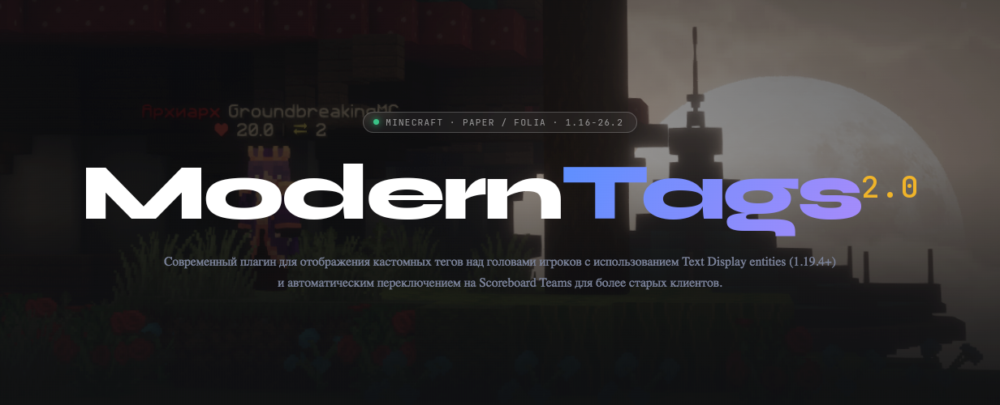

# ModernTags

Настраиваемые теги над игроками для серверов Minecraft. Игроки на 1.19.4 и новее видят теги
из сущностей Text Display, у старых клиентов вокруг обычного ника появляются префикс и суффикс.

[English version](README.md) · [Документация](wiki/ru/README.md)

## Возможности

- **Оформление**: цвета, градиенты, несколько строк, масштаб, фон, тень, выравнивание.
- **Анимация**: любое число кадров со своим текстом и видом.
- **Теги по условиям**: выбор тега по праву, значению PlaceholderAPI или версии клиента,
  отдельно для владельца тега и для каждого зрителя.
- **Свой текст для каждого зрителя**: плейсхолдеры `{viewer:...}` показывают каждому свою версию.
- **Как в ванилле**: тег тускнеет при приседании, пропадает у невидимых и мёртвых игроков,
  а наблюдатели видят то же, что в ванилле.
- **Работает с TAB и плагинами свечения**: их цвета команд сохраняются, теги TAB отключать
  не нужно.
- **Старые клиенты**: теги через команды скорборда и значение под ником, выбираются для
  каждого зрителя.

## Технические детали

- Работает на PacketEvents
- Текст собирается через [GikyMessage](https://github.com/groundbreakingmc/GikyMessage)
- Работает на Spigot, Paper и форках
- Теги обрабатываются вне основного потока сервера

## Требования

- Java 21 и Spigot или Paper 1.20.2 и новее
- [PacketEvents](https://modrinth.com/plugin/packetevents)

Необязательно:

- [PlaceholderAPI](https://www.spigotmc.org/resources/placeholderapi.6245/) для плейсхолдеров
  других плагинов
- [VaultSlim](https://modrinth.com/plugin/vaultslim) или Vault для префиксов и суффиксов
- [LuckPerms](https://luckperms.net/download): если чат Vault предоставляет LuckPerms,
  префиксы и суффиксы читаются из него напрямую

## Быстрый старт

1. Положите PacketEvents и ModernTags в `plugins/` и запустите сервер.
2. Настройте `plugins/ModernTags/config.yml` и теги в `plugins/ModernTags/tags/`.
3. Примените изменения командой `/moderntags reload`.
   Если значение неверное, перезагрузка прервётся с ошибкой в консоли, а прежняя
   конфигурация продолжит работать.

Стандартный конфиг даёт всем тег с префиксом, ником, суффиксом и здоровьем, а игрокам с правом
`moderntags.tag.vip` — анимированный тег.

## Команды и права

| Команда | Описание |
|---|---|
| `/moderntags`, `/moderntags reload` | Перезагрузить конфигурацию |
| `/moderntags update` | Скачать обновление к следующему перезапуску |

| Право | По умолчанию | Описание |
|---|---|---|
| `moderntags.admin` | операторы | Использовать `/moderntags` |
| `moderntags.see.own` | никто | Видеть свой тег |

## Документация

Настройки описаны в комментариях `config.yml` и файлов тегов. В документации — остальное:

- [Текст и плейсхолдеры](wiki/ru/text-and-placeholders.md)
- [Выбор тега](wiki/ru/conditions.md)
- [Примеры](wiki/ru/examples.md)
- [Производительность](wiki/ru/performance.md)

Формат текста тегов описан в wiki GikyMessage:
[шпаргалка](https://github.com/groundbreakingmc/GikyMessage/blob/main/wiki/ru/cheatsheet.md),
[цвета и стили](https://github.com/groundbreakingmc/GikyMessage/blob/main/wiki/ru/colors.md),
[градиенты](https://github.com/groundbreakingmc/GikyMessage/blob/main/wiki/ru/gradients.md),
[условные части текста](https://github.com/groundbreakingmc/GikyMessage/blob/main/wiki/ru/conditions.md),
[преобразования](https://github.com/groundbreakingmc/GikyMessage/blob/main/wiki/ru/transforms.md) и
[экранирование и YAML](https://github.com/groundbreakingmc/GikyMessage/blob/main/wiki/ru/escapes.md).
Имена плейсхолдеров ModernTags перечислены в разделе [«Текст и плейсхолдеры»](wiki/ru/text-and-placeholders.md).

ModernTags отправляет анонимную статистику в [bStats](https://bstats.org). Чтобы её выключить,
поставьте `enabled: false` в `plugins/bStats/config.yml`.

## Лицензия

[Apache License 2.0](LICENSE)
